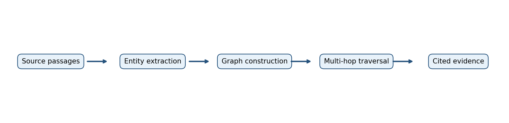
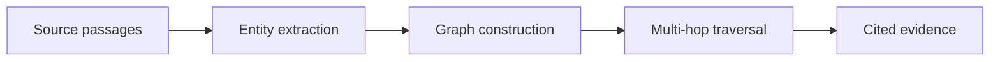

# GraphRAG Knowledge Studio

> Explainable knowledge graph retrieval with entity extraction, multi-hop traversal, and cited source passages.



## Purpose

This project is a **reproducible engineering reference implementation** for a portfolio. It demonstrates real, inspectable program logic and local experiments, not a claim of production deployment or peer-reviewed scientific validation.

## Architecture



## Features

- Runnable Python pipeline with deterministic settings and documented assumptions.
- Automatically saved outputs and machine-readable experiment reports.
- Automated unit tests and continuous-integration workflow.
- Architecture visualization, design notes, debugging and limitations.
- Local-first execution; no API credentials needed for the baseline.

## Installation

```bash
python -m venv .venv
# Linux/macOS: source .venv/bin/activate
# Windows: .venv\Scripts\activate
python -m pip install -r requirements.txt
```

## Run the experiment

```bash
python main.py
python -m unittest discover -s tests -v
```

Generated reports are saved under `outputs/`. Check `docs/EXPERIMENT_REPORT.md` for the recorded local run, and `docs/ARCHITECTURE.md` for the design.

## Source layout

```text
GraphRAG-Knowledge-Studio/
├── main.py                  # main experiment / reference engine
├── requirements.txt         # install dependencies
├── tests/test_core.py       # smoke and interface checks
├── docs/ARCHITECTURE.md     # pipeline diagram
├── docs/EXPERIMENT_REPORT.md
├── docs/RESEARCH_NOTES.md
├── assets/architecture.png
├── outputs/                 # local experiment artifacts
├── .github/workflows/ci.yml
└── README.md
```

## Evaluation and limitations

The outputs are generated from **public tutorial data or synthetic examples**. Results are not clinical performance, production throughput, or evidence of real-world security. There are no undisclosed pretrained models or cloud services. Benchmark claims require external validation, larger test suites and careful ablations.

## Next engineering milestones

1. Replace tutorial/synthetic data with properly licensed public datasets and document provenance.
2. Add stronger baseline comparisons, data leakage checks, and uncertainty intervals.
3. Add API integration tests, packaging, reproducibility locks and a live demonstration.
4. Profile latency and memory; document failure modes and deployment constraints.

## Responsible use

For educational and research engineering use. Do not use any medical-related output for diagnosis or treatment. Do not interpret policy checks as a guarantee of AI safety.

## License

MIT.
